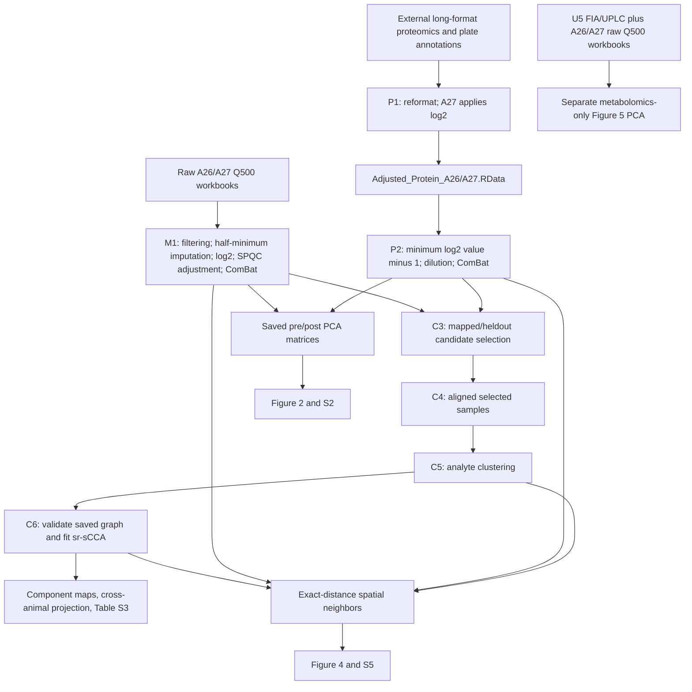

# QCFix workflow

For setup, inputs, dimensions, and commands, see [REPRODUCIBILITY.md](REPRODUCIBILITY.md). For manuscript exports, see [README_Figures.md](README_Figures.md).

## Stage counts

Dimensions below exclude metadata columns.

| Stage | A26 | A27 |
| --- | --- | --- |
| M1 post-ComBat metabolites | 403 samples × 328 analytes | 548 samples × 300 analytes |
| P2 post-ComBat proteins | 427 samples × 9,990 analytes | 566 samples × 10,253 analytes |
| C3/C4 selected samples | 267 | 527 |
| C5 input metabolites | 328 | 300 |
| C5 variable proteins | 9,987 | 10,252 |
| C6 spatially matched samples | 233 | 508 |

The M1/P2 PCA exports precede heldout selection. C3 selects candidates; C4 applies those selections to both modalities. C6 retains samples with spatial coordinates. Repeated cells on a flatmap can display the same sample; the graph uses one coordinate per sample according to the current Rmd matching rule.

## Neighbor definition

`Code/exact_neighbor_orders.R` constructs binary, disjoint groups by exact shortest-path distance. Self and all closer neighbors are excluded. Figure 4 and S5 display orders 1/2/3 for A26 and 1/3/5 for A27.

## External inputs

P1 retains legacy paths requiring local adjustment. A27 P1 also reads `20260120_122736_Identifications.tsv`; this annotation input is not tracked in the repository. See [external-input documentation](README_DukeLibrary.md).

## Output modes

Reproduction mode writes generated data to `outputs/reproduction/Data/` by default.
Downstream stages prefer those regenerated inputs and otherwise use `Data/` references.
Use a fresh run folder for an independent rerun, then compare with
`Code/compare_reproduction.R`. Update mode deliberately replaces files in `Data/`.
Graph rebuilding requires a separate explicit option; saved graphs are validated
and loaded by default. See [mode configuration](REPRODUCIBILITY.md#reproduction-mode-and-reference-updates).
